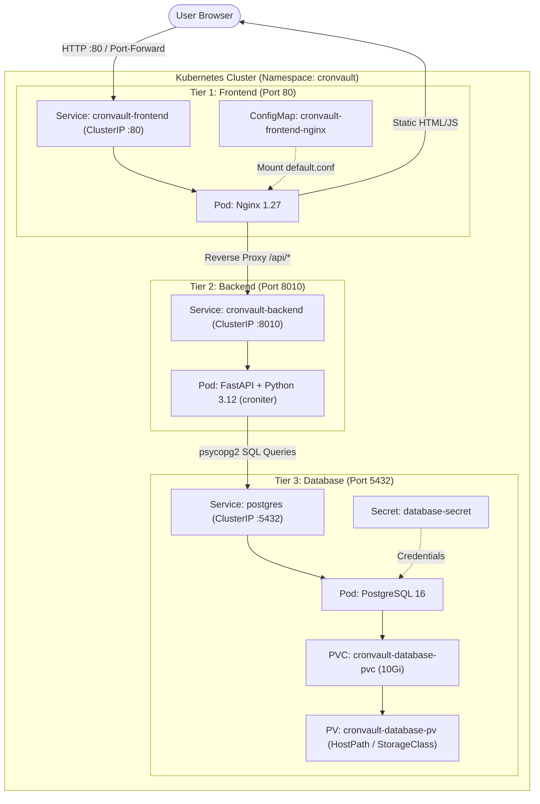

# ⏱️ CronVault

> **Cloud-Native, Multi-Tenant Cron Job Management Platform**  
> A resilient 3-tier architecture built with **FastAPI**, **PostgreSQL**, and **Nginx**, orchestrated on **Kubernetes** with persistent storage.

---

## 🌟 Overview

**CronVault** is a modern, enterprise-grade cron management and mission-control platform. It allows engineering teams and organizations to manage, monitor, and trigger scheduled workloads across servers, Docker hosts, and Kubernetes clusters in a multi-tenant, isolated environment.

### Key Highlights
- **3-Tier Cloud-Native Architecture**: Clean separation of concerns between Frontend (Nginx), Application (FastAPI), and Database (PostgreSQL).
- **Multi-Tenant Isolation**: Secure PBKDF2-HMAC-SHA256 authentication, company scoping, and HttpOnly session cookies.
- **Smart Cron Scheduler**: Powered by `croniter` supporting standard 5-part cron syntax (`*/5 * * * *`, `0 2 * * *`) and human-readable aliases (`@daily`, `@hourly`, `every 15 minutes`).
- **Modern Glassmorphism UI**: High-density dashboard with live execution countdowns, interactive timeline, run logs, host topology, and light/dark theme switching.
- **Full Job Lifecycle**: One-click manual triggers ("Run Now"), Pause/Resume toggles, command copy, edit, and deletion.
- **Persistent Storage**: Kubernetes `PersistentVolume` and `PersistentVolumeClaim` backed storage ensuring zero data loss across database pod restarts.

---

## 🏗️ System Architecture



---

## 📂 Repository Structure

```text
.
├── backend/
│   ├── app.py                      # FastAPI REST application & DB models
│   ├── Dockerfile                  # Python 3.12 slim backend container image
│   ├── docker-compose.yml          # Local backend + db docker-compose setup
│   ├── deploy-backend.yml          # CI/CD deployment workflow template
│   └── dashboard-redesigned.html   # Synchronized dashboard UI copy
├── frontend/
│   ├── Dockerfile                  # Nginx 1.27 image with baked UI
│   ├── nginx.conf                  # Nginx reverse proxy configuration
│   ├── docker-compose.frontend.yml # Standalone frontend compose configuration
│   ├── dashboard-redesigned.html   # Primary modern dashboard source
│   └── index.html                  # Production web entrypoint
├── k8s/
│   ├── namespace.yml               # Dedicated 'cronvault' namespace
│   ├── secrets.yml                 # Encrypted DB credentials (Base64)
│   ├── database-pv.yml             # 10Gi PersistentVolume definition
│   ├── database-pvclaim.yml        # PersistentVolumeClaim for PostgreSQL
│   ├── database-deployment.yml     # PostgreSQL 16 Deployment
│   ├── database-service.yml        # PostgreSQL internal ClusterIP Service
│   ├── backend-deployment.yml      # FastAPI application Deployment
│   ├── backend-service.yml         # FastAPI internal ClusterIP Service
│   ├── frontend-nginx-configmap.yml# Nginx reverse-proxy ConfigMap
│   ├── frontend-deployment.yml     # Nginx Frontend Deployment
│   └── frontend-service.yml        # Frontend Service (ClusterIP :80)
└── README.md                       # Complete Project Documentation
```

---

## 🚀 Getting Started

### Prerequisites
- [Docker](https://docs.docker.com/get-docker/) & [Docker Compose](https://docs.docker.com/compose/)
- [Kubectl](https://kubernetes.io/docs/tasks/tools/)
- A running Kubernetes cluster ([Minikube](https://minikube.sigs.k8s.io/docs/), Kind, EKS, or GKE)

---

### Deploying on Kubernetes

Deploy the entire 3-tier stack onto Kubernetes using the manifests in the `k8s/` directory.

#### 1. Apply Manifests in Sequence

```bash
# 1. Create the dedicated namespace
kubectl apply -f k8s/namespace.yml

# 2. Apply database credentials
kubectl apply -f k8s/secrets.yml

# 3. Create persistent storage (PV & PVC)
kubectl apply -f k8s/database-pv.yml
kubectl apply -f k8s/database-pvclaim.yml

# 4. Deploy PostgreSQL Database & Service
kubectl apply -f k8s/database-deployment.yml
kubectl apply -f k8s/database-service.yml

# 5. Deploy FastAPI Backend & Service
kubectl apply -f k8s/backend-deployment.yml
kubectl apply -f k8s/backend-service.yml

# 6. Deploy Frontend Nginx ConfigMap, Deployment & Service
kubectl apply -f k8s/frontend-nginx-configmap.yml
kubectl apply -f k8s/frontend-deployment.yml
kubectl apply -f k8s/frontend-service.yml
```

Alternatively, apply all files at once:
```bash
kubectl apply -f k8s/
```

#### 2. Verify Cluster Status

Ensure all pods, services, and persistent volumes are running and bound:

```bash
kubectl get all,pv,pvc -n cronvault
```

Expected output:
```text
NAME                                      READY   STATUS    RESTARTS   AGE
pod/cronvault-backend-xxxxxxxxx-xxxxx     1/1     Running   0          2m
pod/cronvault-database-xxxxxxxxx-xxxxx    1/1     Running   0          2m
pod/cronvault-frontend-xxxxxxxxx-xxxxx    1/1     Running   0          2m

NAME                         TYPE        CLUSTER-IP       PORT(S)
service/cronvault-backend    ClusterIP   10.100.221.219   8010/TCP
service/cronvault-frontend   ClusterIP   10.111.198.222   80/TCP
service/postgres             ClusterIP   10.104.127.41    5432/TCP

NAME                                           STATUS   VOLUME                  CAPACITY
persistentvolumeclaim/cronvault-database-pvc   Bound    cronvault-database-pv   10Gi
```

#### 3. Access the Dashboard

Forward the frontend port to your local machine:

```bash
kubectl port-forward -n cronvault svc/cronvault-frontend 8080:80
```

Open your browser and navigate to:
👉 **[http://localhost:8080](http://localhost:8080)**

---

## 🗄️ Database Management & Inspection

The database is isolated inside the private cluster network. You can query and inspect records directly using `kubectl`:

### Interactive `psql` Terminal
```bash
kubectl exec -it -n cronvault $(kubectl get pod -n cronvault -l app=cronvault-database -o jsonpath='{.items[0].metadata.name}') -- psql -U admin -d admin
```

### Useful SQL Queries
```sql
-- View all registered organizations / companies
SELECT * FROM companies;

-- View registered users
SELECT id, full_name, email, role FROM users;

-- View scheduled cron jobs
SELECT id, name, schedule, host, enabled FROM jobs;

-- Check table schema
\dt
\d jobs
```

### External GUI Connection (DBeaver / TablePlus / pgAdmin)
```bash
kubectl port-forward -n cronvault svc/postgres 5432:5432
```
- **Host**: `localhost` / `127.0.0.1`
- **Port**: `5432`
- **Database**: `admin`
- **User**: `admin`
- **Password**: `postgres` (or as configured in `k8s/secrets.yml`)

---

## 📡 REST API Reference

All backend endpoints are prefixed under `/api`. Unauthenticated requests to protected endpoints return `401 Unauthorized`.

| Method | Endpoint | Description | Auth Required |
| :--- | :--- | :--- | :--- |
| `POST` | `/api/auth/signup` | Register new organization & admin user | No |
| `POST` | `/api/auth/login` | Authenticate and issue HttpOnly session cookie | No |
| `POST` | `/api/auth/logout` | Revoke session and clear cookie | Yes |
| `GET` | `/api/auth/me` | Fetch current session and company info | Yes |
| `GET` | `/api/jobs` | List all jobs for authenticated company | Yes |
| `POST` | `/api/jobs` | Create a new scheduled job | Yes |
| `GET` | `/api/jobs/{id}` | Retrieve specific job details | Yes |
| `PUT` | `/api/jobs/{id}` | Update job schedule, command, or metadata | Yes |
| `DELETE`| `/api/jobs/{id}` | Remove a scheduled job | Yes |
| `PATCH`| `/api/jobs/{id}/toggle` | Enable or pause job execution (`{"enabled": bool}`) | Yes |
| `POST` | `/api/jobs/{id}/run` | Manually record or trigger immediate execution | Yes |

---

## 🛡️ Security Model

- **Per-Tenant Scoping**: All job rows enforce `company_id`. Queries strictly filter by the authenticated session token's company ID.
- **Credential Storage**: Passwords hashed using `PBKDF2-HMAC-SHA256` with 200,000 iterations and cryptographic salts.
- **Zero-Storage Client Auth**: No JWT tokens stored in `localStorage` or accessible to scripts; authentication relies on server-managed `HttpOnly`, `SameSite=Lax` cookies.
- **Cluster Isolation**: Database and backend services run on internal `ClusterIP` networks, exposed to clients only through the Nginx reverse-proxy ingress point.

---

## 📜 License

This project is open-source and available under the [MIT License](LICENSE).
